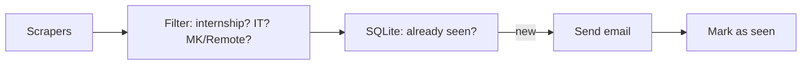

# Internship Alert Agent

I'm a Computer Science student at FINKI in Skopje, and every internship season I ended up opening the same 20+ career pages again and again, hoping something new showed up. Most of the time nothing did, and when something finally did, I usually found it too late.

So I built a small bot that does the checking for me. Every 6 hours it goes through the career pages of some companies, finds new internship postings that fit what I'm looking for, and sends me an email. It runs on GitHub Actions, so it keeps working even when my laptop is off.

## What it does

- Checks **16 sources** automatically every 6 hours (company career pages + Macedonian job boards)
- Recognizes internship postings in **English, Macedonian and German** ("intern", "пракса", "практикант", "Praktikant"...)
- Skips non-IT internships (marketing, sales, finance, legal...)
- Keeps only positions in **North Macedonia** or **Remote**
- Remembers what it already found, so I never get the same posting twice
- Sends **one email** with all new postings: company, position, location, short description and a link to apply
- Adding a new company is usually just a few lines in a YAML file

## How it works



1. Every scraper returns a list of `Job` objects in the same format, no matter where the data came from.
2. The filter throws out anything that isn't an IT internship in Macedonia or remote.
3. The remaining jobs are checked against a small SQLite database of postings I've already been notified about.
4. If anything is new, I get an email, and only **after** the email is sent successfully are the jobs saved as "seen".
5. GitHub Actions commits the updated database back to the repo, so the next run knows what was already sent.

## Sources

A lot of companies don't host job listings themselves, they use an applicant tracking system (ATS). Many of those have public JSON APIs, so one scraper can cover several companies.

| Type | Companies |
|---|---|
| Greenhouse | Loka, Proton, Slice |
| SmartRecruiters | Endava |
| Ashby | IT Labs |
| Teamtailor | Nion, iBorn |
| TalentLyft | HTEC |
| WordPress REST API | Solutionade |
| schema.org JSON-LD | vector8 |
| Custom HTML | Netcetera, CodeChem, RLDatix, SORSIX |
| Job boards | vrabotuvanje.com.mk, Joberty |

## Project structure

```
agent/
  models.py         # Job dataclass
  filters.py        # internship / IT field / location checks
  storage.py        # SQLite, remembers seen jobs
  notifier.py       # sends the email (Gmail SMTP)
  scrapers/         # one file per source type
config/
  companies.yaml    # which companies to check and how
data/
  jobs.db           # seen jobs (updated by GitHub Actions)
main.py             # runs everything
.github/workflows/check-internships.yml
```

## Running it locally

```bash
git clone https://github.com/angelakristo/internship-alert-agent.git
cd internship-alert-agent
python3 -m venv .venv
source .venv/bin/activate
pip install -r requirements.txt
```

Create a `.env` file (see `.env.example`):

```
EMAIL_SENDER=your.address@gmail.com
EMAIL_APP_PASSWORD=your16charapppassword
EMAIL_RECIPIENT=your.address@gmail.com
```

The password is a Gmail **App Password**, not your normal password (you need 2-Step Verification turned on to create one).

Then:

```bash
python main.py --dry-run   # shows what it would send, doesn't email or save anything
python main.py             # the real thing
```

## Running it on GitHub Actions

Add the same three values as repository secrets (`Settings → Secrets and variables → Actions`). The workflow runs every 6 hours, and you can also start it manually from the Actions tab.

## Adding a company

If the company uses an ATS that's already supported, it's just a few lines in `config/companies.yaml`:

```yaml
  - name: Slice
    type: greenhouse
    board_token: slice
```

If the company has its own custom career page, it needs a small scraper in `agent/scrapers/` (see `netcetera.py` or `codechem.py` for simple examples).

## Some decisions I made along the way

- **Filter first, then check the database.** Only relevant jobs get saved. If I improve the filter later, postings it wrongly skipped before can still show up.
- **Mark as seen only after the email is sent.** If sending fails, the bot just tries again next run instead of silently losing the posting.
- **JSON APIs over HTML whenever possible.** HTML scrapers break every time a company redesigns its website. ATS APIs almost never change.
- **A broken scraper fails the whole run.** If one source breaks, the other ones still run, but the workflow ends up red and GitHub emails me. Otherwise a scraper could be broken for months without me noticing.
- **Monthly heartbeat commit.** GitHub disables scheduled workflows in public repos after 60 days without activity. Since the bot only commits when it finds something new, it also updates `data/last_heartbeat.txt` once a month to stay alive.
- **Being polite to websites.** One check every 6 hours, a pause between requests, and an honest User-Agent.

## Limitations

- Some companies don't have a career page at all and only post on LinkedIn, which I don't scrape. Some of them post on vrabotuvanje.com.mk, so they're partly covered.
- A few websites block requests from GitHub's servers, so I removed them.
- The filter is keyword-based. A posting with a very unusual title could slip through or get missed.
- Remote positions from other countries pass the filter on purpose, even though some of them are only open to people living in that country.

## Tech

Python 3.12 · Requests · BeautifulSoup · SQLite · PyYAML · GitHub Actions · Gmail SMTP
